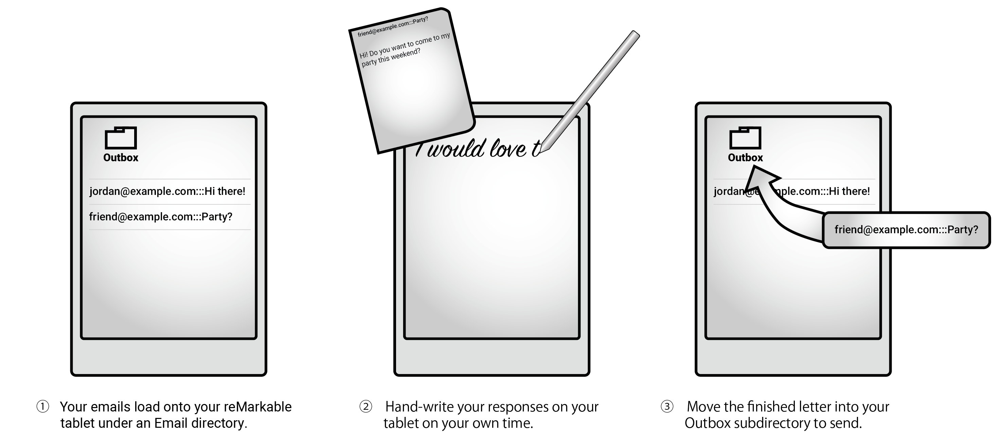

<h1 align=center></h1>

<p align=center>&nbsp; 
</p>



I find writing emails to be one of the most tedious and unpleasant tasks of my day. But I find the act of handwriting to be one of the most pleasant! The reMarkable is an e-ink tablet with a very pleasant writing experience. This software allows you to respond to emails by writing on the reMarkable, and then sends an OCR'd version of your writing to the recipient.

---

See [docs/Overview.md](docs/Overview.md) to see an example in action!

---

`epistolary receive` turns each unread email into a PDF (one message per file, named `Subject - Sender`) with a ruled page at the end, and puts it in an `Emails` folder on your device. Write your reply on the ruled page (add more pages if you need them), then move the file to `Emails/Outbox`. `epistolary send` transcribes the handwriting, shows you the result, and sends it as a reply. Sent files move to `Emails/_Archive`.

To write a new email rather than a reply, create a notebook named `recipient@example.com:::My subject`, write it, and move it to the `Outbox`.

Epistolary never marks your mail as read, and it only archives what it has sent. It remembers what it has uploaded in a state file next to the config (`epistolary.state.json`), and it flags emails you have replied to as answered.

## Architecture

Three small interfaces, each with pluggable backends:

-   `MailboxManager`: lists unread mail, downloads it, and sends replies. Backend: IMAP and SMTP.
-   `DocumentManager`: an inbox, an outbox, and an archive of PDFs. Backends: a reMarkable tablet (through `rmapi` and `remarks`), or a directory on disk.
-   `TextExtractor`: handwriting to text. Backends: OpenAI vision models, or Tesseract.

`EpistolaryOrchestrator` runs the receive and send flows on top of them.

## Installation

### 0. Requirements

-   For the reMarkable: [`rmapi`](https://github.com/ddvk/rmapi) on your `PATH`, logged in to your account. The `remarks` renderer is installed by `uv sync` (see below) and needs `cairo`: `brew install pkg-config cairo` on macOS.
-   For OpenAI transcription: an API key in `OPENAI_API_KEY`.
-   For Tesseract transcription: the `tesseract` binary, for example `brew install tesseract`.

### 1. Install

From a checkout:

```bash
uv sync
```

From PyPI, `pip install epistolary` gets everything except `remarks`, which only lives on GitHub. Add it for reMarkable support:

```bash
pip install git+https://github.com/azeirah/remarks
```

### 2. Configure

The wizard asks for each setting and checks the login:

```bash
uv run epistolary init
```

Or write `~/.config/epistolary.json` yourself. Passwords are stored base64-encoded (`python -c 'import base64;print(base64.b64encode(b"hunter2").decode())'`), which hides them from a glance and nothing more. Keep the file private; `init` writes it `0600`.

```jsonc
{
    "email": "you@example.com",
    "password": "aHVudGVyMg==",
    "imap": { "host": "imap.example.com", "port": 993 },
    "smtp": { "host": "smtp.example.com", "port": 587 },

    // Optional, defaults shown
    "smtp_username": null,
    "smtp_password": null,             // base64, like "password"
    "ignore_marketing_emails": true,   // skip mailing lists and marketing (a List-Unsubscribe header)
    "folder": "INBOX",
    "limit": 10,                       // emails per `receive`, newest first
    "document_manager": "remarkable",  // or "files", or "module:Class"
    "document_manager_kwargs": {},     // e.g. {"root": "Emails"} or {"root": "~/Epistolary"}
    "text_extractor": "openai",        // or "tesseract", or "module:Class"
    "text_extractor_kwargs": {}        // e.g. {"model": "gpt-4o", "dpi": 150}
}
```

Pass `--config PATH` to any command to use a different file.

## Usage

```bash
uv run epistolary receive           # unread emails onto the device
uv run epistolary receive --prune   # also archive documents whose email you have since read elsewhere
uv run epistolary send              # show each transcription and ask before sending
uv run epistolary send --dry-run    # show and send nothing
uv run epistolary send --yes        # send without asking, for cron
```

Add `--debug` before the command for verbose logging.

The same from Python:

```python
from epistolary.config import EpistolaryConfig

epistolary = EpistolaryConfig.from_file().orchestrator("~/.config/epistolary.state.json")  # any path you like
epistolary.receive()
epistolary.send(confirm=lambda to, subject, body: print(to, subject, body) or True)
```

or assemble the pieces yourself:

```python
from epistolary.document_manager import RemarkableDocumentManager
from epistolary.mailbox_manager import SMTPIMAPMailboxManager
from epistolary.orchestrator import EpistolaryOrchestrator
from epistolary.text_extractor import OpenAITextExtractor

epistolary = EpistolaryOrchestrator(
    SMTPIMAPMailboxManager("imap.example.com", 993, "you@example.com", "hunter2", "smtp.example.com", 587),
    RemarkableDocumentManager(root="Emails"),
    OpenAITextExtractor(),
    state_path="~/.config/epistolary.state.json",
)
```

## Upgrading from 0.2

Send or archive whatever is in your `Outbox` first; then `receive` will fill `Emails/` under the new names beside anything already there. Old-style `Outbox` documents still send, as new messages rather than threaded replies. If you set `smtp_password` by hand, base64-encode it like `password`.

## Known Limitations

-   No support for inline images or attachments yet.
-   Replies go to the sender (or `Reply-To`) only, never to `Cc`.
-   Transcription is good, not perfect. `send` shows you the text first for a reason.

## Troubleshooting

### Cairo / pkg-config

On macOS, `remarks` needs `cairo` and `pkg-config`:

```bash
brew install pkg-config cairo
```

If the Python packages were installed before cairo was, reinstall them:

```bash
rm -rf .venv
uv sync
```

### `openai` transcription

Set `OPENAI_API_KEY` in your environment, or pass `{"api_key": "..."}` in `text_extractor_kwargs`.
